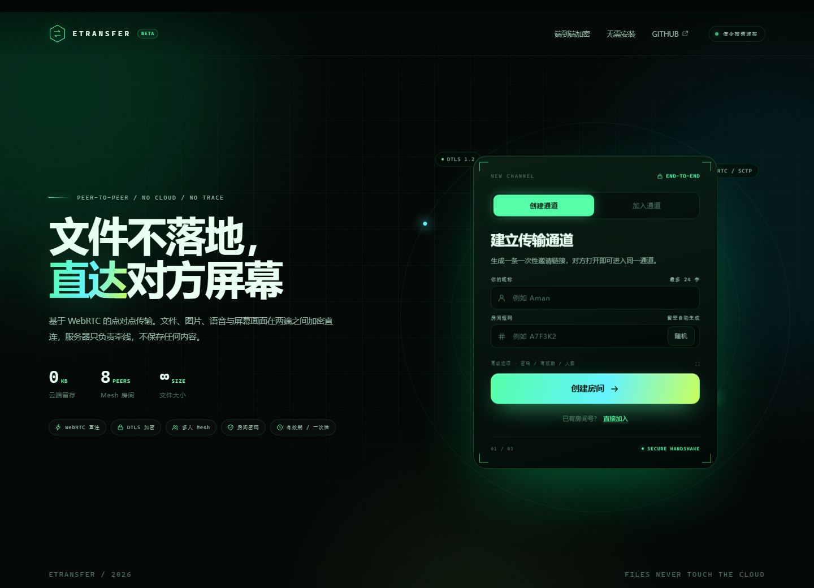
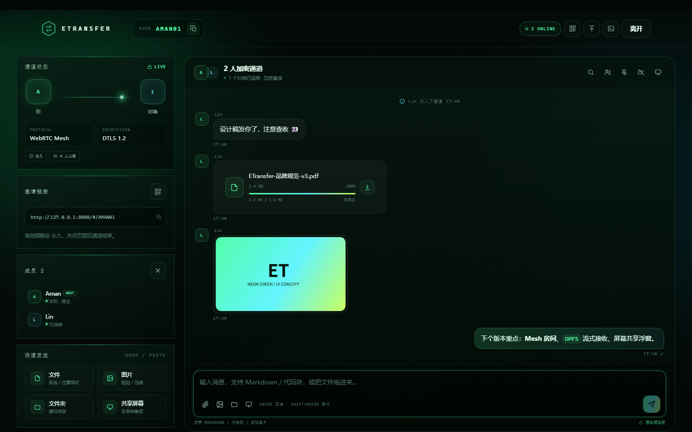
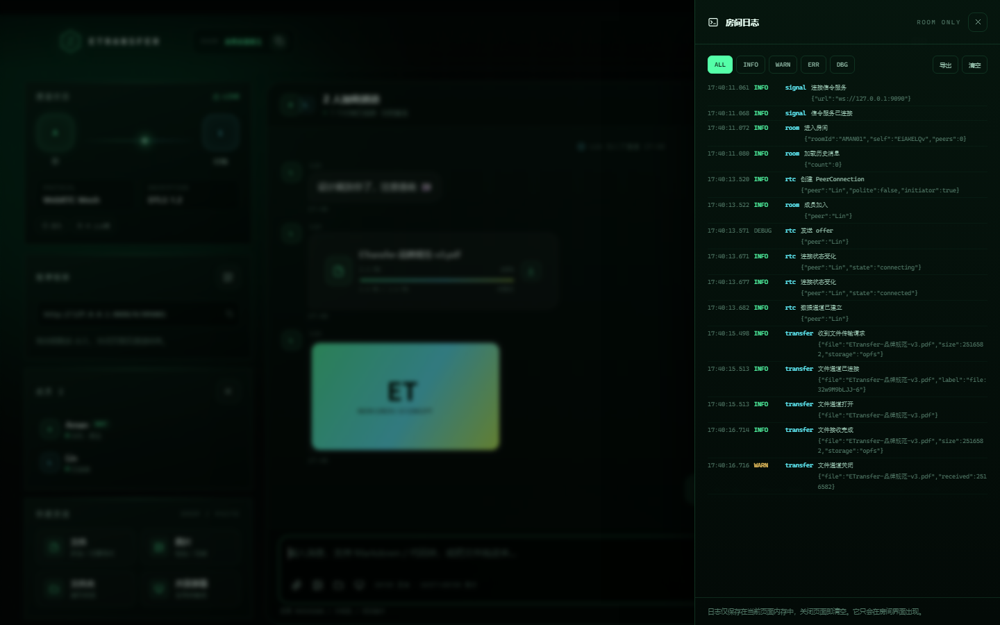

<div align="center">

</div>

### ETransfer · 点对点文件、聊天与屏幕共享

基于 WebRTC 的浏览器点对点传输工具。文件、图片、聊天与屏幕画面在参与者之间加密直连，服务器只负责房间与信令，不保存文件内容。

- 前端：Vue 3 + Vite 时代之前的 Vue CLI 5，**已移除 PrimeVue / PrimeFlex / PrimeIcons**，使用自研绿色霓虹设计系统
- 后端：Node.js + `ws`，提供信令、房间管理、链接预览与可选中继
- 部署：纯静态前端 + 一个 Node 服务，支持 PWA / Share Target

## 界面预览

### 首页



### 房间



### 邀请与日志

<p align="center">
  
  
</p>

## 功能

| 模块 | 能力 |
|---|---|
| 房间 | 6 位短码、二维码邀请、房间密码、有效期、一次性房间、房主踢人、房主迁移、2~8 人 Mesh |
| 传输 | 多文件 / 文件夹拖拽、传输队列、暂停 / 继续 / 取消、速度与剩余时间、背压控制、OPFS 流式落盘、接收确认 |
| 分享 | 剪贴板图片、PWA Share Target（从系统分享面板发文件）、邀请链接 |
| 沟通 | 文本 Markdown / 代码高亮、链接预览、图片画廊、消息持久化（IndexedDB）、搜索、撤回 |
| 通话 | 麦克风、摄像头、屏幕共享（含系统音频）、多人 Mesh 媒体；屏幕共享独立浮窗，可拖动、缩放、最大化、全屏 |
| 兜底 | P2P 失败时手动上传到服务器中继，生成短时下载链接 |
| 可观测 | 仅房间内可见的终端风日志抽屉：信令、RTC、传输、媒体事件 |

## 架构

```
浏览器 A ── WebSocket ──┐
                        ├── 信令 / 房间 / 预览 / 中继（Node）
浏览器 B ── WebSocket ──┘
    │
    └──── WebRTC Mesh：DataChannel（聊天/文件）+ Media（音视频/屏幕）────┘
```

## 快速开始

要求 Node.js >= 18.17。

```bash
# 1. 信令服务（9090）
cd server
npm install
npm start

# 2. 前端开发服务器（8080）
cd client
npm install
npm run serve
```

打开 `http://localhost:8080`。开发模式下前端自动连接 `ws://localhost:9090` 与 `http://localhost:9090/api`。

信令连接是按需建立的：首页加载时不会连接 WebSocket，只有点击「创建房间 / 加入房间」时才连接；离开房间后会自动断开。

生产构建：

```bash
cd client
npm run build
# 产物在 client/dist，由 Nginx / CDN 托管
```

## 配置

### 前端

在 `client/public/index.html` 中可覆盖：

```html
<script>
  window.WSURL = 'wss://your-domain.com/ws'
  window.API_URL = ''
  window.WEBRTC_CONFIG = {
    iceServers: [
      { urls: 'stun:stun.example.com:3478' },
      { urls: 'turn:turn.example.com:3478', username: 'user', credential: 'pass' }
    ]
  }
</script>
```

未设置时：开发环境自动使用 `:9090`；生产环境默认同域 `/ws` 与 `/api`。

### 服务端

见 [server/README.md](./server/README.md)。常用变量：

```bash
HOST=127.0.0.1 PORT=9090 \
ALLOWED_ORIGINS=https://your-domain.com \
MAX_USERS=8 RELAY_ENABLED=true \
LOG_LEVEL=info npm start
```

## 生产部署

```nginx
server {
    listen 443 ssl;
    server_name your-domain.com;
    root /var/www/etransfer/dist;

    location / {
        try_files $uri $uri/ /index.html;
    }

    location /ws {
        proxy_pass http://127.0.0.1:9090;
        proxy_http_version 1.1;
        proxy_set_header Upgrade $http_upgrade;
        proxy_set_header Connection "upgrade";
        proxy_set_header Host $host;
        proxy_read_timeout 120s;
    }

    location /api/ {
        proxy_pass http://127.0.0.1:9090;
        proxy_set_header Host $host;
    }
}
```

HTTPS 是麦克风、摄像头、屏幕共享和 Service Worker 的前提；本地 `localhost` 除外。

## PWA

- `client/public/manifest.webmanifest` 声明安装信息与 Share Target。
- `client/public/sw.js` 负责应用壳缓存和 `POST /share-target`：系统分享的文件写入 IndexedDB，随后跳回首页，进入房间后自动加入传输队列。
- 仅在 `npm run build` 的产物中注册 Service Worker；开发环境不注册，避免缓存干扰。

## 中继兜底

默认把文件写到 `server/data/relay/`，元数据带 TTL，下载地址为随机 21 位 ID。

- 传输失败时，传输队列里会出现「上传中转」按钮，需用户确认后才会把文件发往服务器。
- 这是**本地磁盘存储适配器**，`server/relay-store.js` 的 `put/get/sweep` 接口可以直接替换为 S3 / OSS / R2 实现。
- 生产环境应同时设置 `ALLOWED_ORIGINS`、`RELAY_MAX_BYTES`、`RELAY_TTL`，并定期清理。

## 大文件接收

- 发送端每次只读取 64KB 分片，并用 `bufferedAmount` + 接收端 8MB 确认窗口做双重背压，内存不随文件大小增长。
- 接收端把每个分片直接写入 **OPFS**（Origin Private File System），JS 堆中不保留整份文件；完成后再从 OPFS 流式「另存为」或下载。
- 不支持 OPFS 的浏览器退回内存聚合，并限制单文件 128MB，超过会拒绝并提示改用服务器中转。
- OPFS 缓存会在启动时清理 7 天未访问的文件；接收中的缓存会在取消/失败/离开时删除。

## 已知限制

- 刷新页面会断开当前 WebRTC 连接，需要用同一短码重新加入；房间历史消息会从 IndexedDB 恢复。
- 暂停/继续只作用于当前会话，刷新后不会从断点续传。
- 公网对称 NAT 下仍需要 TURN；项目默认只内置公共 STUN。
- 房主身份绑定当前连接，刷新后房主会按服务端规则迁移给下一位成员。
- 不支持 OPFS 且文件超过 128MB 时只能使用「上传中转」。

## 目录

```
client/                Vue 3 前端（自研 UI）
server/                信令 / 房间 / 预览 / 中继
design-preview/        已确认的静态视觉稿
```

## 测试

```bash
cd server && npm test      # 20 个单元 / 集成测试
cd client && npm run lint  # ESLint
cd client && npm run build # 生产构建验证
```
