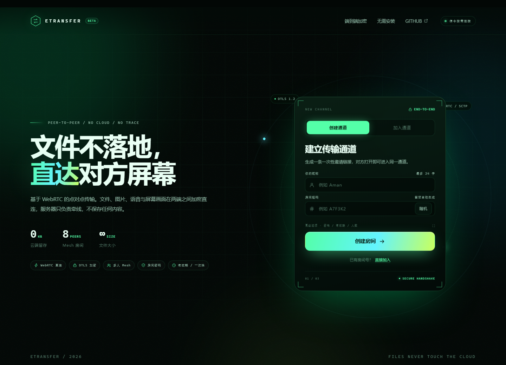
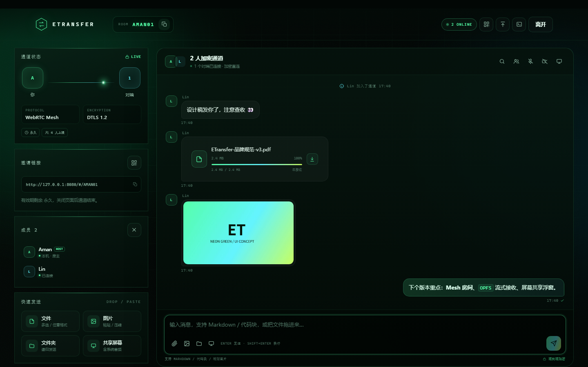
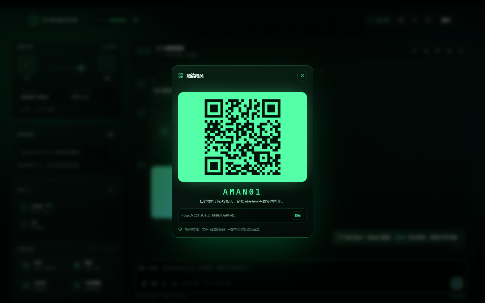
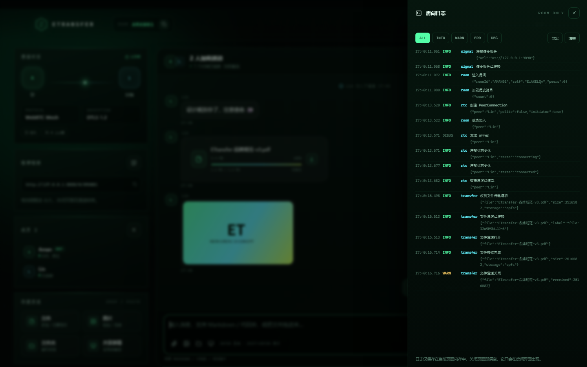

# ETransfer · 点对点文件、聊天与屏幕共享

基于 WebRTC 的浏览器点对点传输工具。文件、图片、聊天与屏幕画面在参与者之间加密直连，服务器只负责房间与信令，不保存文件内容。

- 前端：Vue 3 + Vue CLI，纯静态，构建到 `frontend/dist`
- 后端：Go + Fiber，直接托管 `frontend/dist`，只提供 WS/SSE 信令
- 传输：文件、聊天、音视频全部走 WebRTC DataChannel / MediaStream

## 界面预览

### 首页



### 房间



### 邀请与日志

<p align="center">
  
  
</p>

## 功能

| 模块 | 能力 |
|---|---|
| 房间 | 6 位短码、二维码邀请、房间密码、有效期、一次性房间、房主踢人、房主迁移、2~8 人 Mesh |
| 传输 | 多文件 / 文件夹拖拽、传输队列、暂停 / 继续 / 取消、速度与剩余时间、背压控制、OPFS 流式落盘、接收确认 |
| 分享 | 剪贴板图片、PWA Share Target、邀请链接 |
| 沟通 | 纯文本、图片画廊、消息持久化（IndexedDB）、搜索、撤回 |
| 通话 | 麦克风、摄像头、屏幕共享（含系统音频）、多人 Mesh 媒体；屏幕共享独立浮窗，可拖动、缩放、最大化、沉浸全屏 |
| 可观测 | 仅房间内可见的日志抽屉：信令、RTC、传输、媒体事件 |

## 架构

```text
浏览器 A ── WS / POST+SSE ──┐
                            ├── Go + Fiber：房间 / 信令（唯一后端）
浏览器 B ── WS / POST+SSE ──┘
    │
    └── WebRTC Mesh：DataChannel（聊天/文件） + Media（音视频/屏幕）
```

Go 服务同时托管：

```text
/                 frontend/dist 静态文件
/ws               WebSocket 信令（SIGNAL_TRANSPORT=both|ws）
/api/events       SSE 下行（SIGNAL_TRANSPORT=both|sse）
/api/signal       SSE 上行
/health           健康检查
```

## 快速开始

要求 Node.js >= 18.17、Go >= 1.26。

```bash
# 1. 构建前端并生成 embed 资源
go generate .

# 2. 编译单二进制
go build -trimpath -ldflags="-s -w" -o etransfer .

# 3. 启动
./etransfer
```

打开 `http://localhost:9090`。

开发模式（读取外部 `frontend/dist`，不嵌入）：

```bash
go run -tags dev .
```

## 信令传输

默认同时启动 WebSocket 和 SSE：

```bash
SIGNAL_TRANSPORT=both go run .   # 默认
SIGNAL_TRANSPORT=ws go run .     # 只开 WS
SIGNAL_TRANSPORT=sse go run .    # 只开 SSE
```

客户端默认 WebSocket；使用 SSE 时：

```js
window.SIGNAL_TRANSPORT = 'sse'
```

或：

```text
http://localhost:9090/?transport=sse
```

- `ws`：`/api/events`、`/api/signal` 返回 404
- `sse`：不接受 `/ws` upgrade
- `both`：两种同时可用

SSE 首帧返回 `client_id` + `token`，后续上行消息 POST 到 `/api/signal`。

## 配置

| 环境变量 | 默认值 | 说明 |
|---|---|---|
| `HOST` / `PORT` | `0.0.0.0` / `9090` | 监听地址 |
| `STATIC_DIR` | `frontend/dist` | 前端构建目录 |
| `SIGNAL_TRANSPORT` | `both` | `both` / `ws` / `sse` |
| `ALLOWED_ORIGINS` | 空 | CORS 白名单，逗号分隔 |
| `MAX_USERS` | `8` | 单房间人数上限 |
| `MAX_ROOM_ID_LENGTH` | `12` | 房间号最大长度 |
| `DEFAULT_EXPIRY_MINUTES` | `180` | 默认有效期 |
| `MAX_EXPIRY_MINUTES` | `1440` | 最长有效期 |
| `MAX_PAYLOAD` | `65536` | 单条消息最大字节数 |

## PWA

- `frontend/public/manifest.webmanifest` 声明安装信息与 Share Target
- `frontend/public/sw.js` 缓存应用壳，并处理 `POST /share-target`
- 仅生产构建注册 Service Worker

## 大文件接收

接收端优先使用 OPFS 流式写入，避免把大文件全部放进内存；不支持 OPFS 时退回内存，并限制在 128MB 内。发送端使用 64KB 分片、`bufferedAmount` 背压和接收端 ACK 窗口。

## TURN

公网或严格 NAT 环境需要 TURN：

```html
<script>
  window.WEBRTC_CONFIG = {
    iceServers: [
      { urls: 'stun:stun.example.com:3478' },
      { urls: 'turn:turn.example.com:3478', username: 'user', credential: 'pass' }
    ]
  }
</script>
```

## 目录

```text
frontend/                Vue 3 前端源码
internal/                Go 业务包（config/protocol/room/signaling/web/app）
main.go                  单二进制入口
assets_*.go              内嵌 / 开发模式静态资源
docs/screenshots/        README 截图
```

## 测试

```bash
go test ./...
go build -trimpath -ldflags="-s -w" -o etransfer .
cd frontend && npm run lint && npm run build
```

## Vercel Services（尝试）

`vercel.json` 使用 Vercel Services 把 Go 服务作为单个 `app` service：

- `runtime: go`
- 构建时先执行 `frontend` 的 `npm ci && npm run build`
- 再 `go build`，前端通过 `go:embed` 进入二进制
- 所有路径 rewrite 到 `app`

这依赖 Vercel 账号支持 **Services + Go runtime**。如果控制台提示 runtime 不支持，Vercel 就不能运行这个常驻 GoFiber 服务，改用 Railway / Fly.io / VPS 或容器部署。
